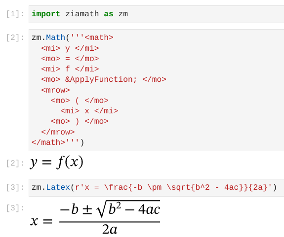

# ziamath

Render MathML or LaTeX Math expressions as SVG using pure Python. Does not require a Latex installation, nor a network connection.

Ziamath comes with the STIXTwoMath-Regular font installed for use by default.
Other Math-enabled Open Type fonts (TTF or OTF files) may also be used.

Documentation is available at [readthedocs](https://ziamath.readthedocs.io).

Try it online with the [ziamath web app](https://cdelker.codeberg.page/ziamath-app), which runs ziamath in your browser through pyodide to render LaTeX equations to SVG with several font options.
